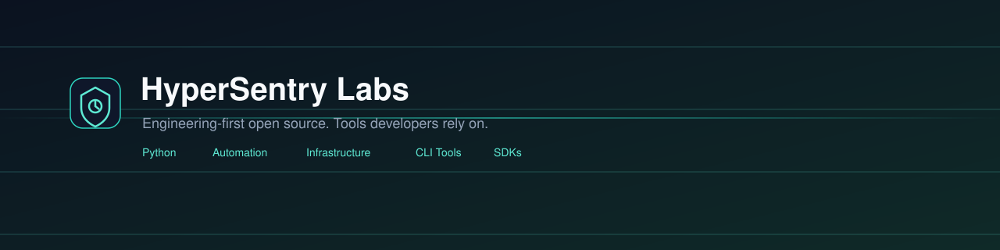

<picture>
  <source media="(prefers-color-scheme: dark)" srcset="assets/banner-dark.svg">
  <source media="(prefers-color-scheme: light)" srcset="assets/banner-light.svg">
  
</picture>

 

## About

HyperSentry Labs is an independent engineering organization founded and
maintained by
[Matin Shahabadi (@power0matin)](https://github.com/power0matin).

We build practical developer software with an emphasis on reliability,
maintainability, and a small operational footprint. Our current public work is
focused on FiveM tooling; the broader direction includes backend utilities,
automation, CLI applications, and infrastructure software as those projects
become ready to maintain properly.

We prefer a small portfolio of finished, documented projects over a large
collection of demos.

## Current projects

| Project | Type | Status | Purpose |
| --- | --- | --- | --- |
| [hs-loadingscreen](https://github.com/HyperSentry-Labs/hs-loadingscreen) | Open source | Active | Lightweight standalone FiveM loading screen |

The organization-level [roadmap](https://github.com/HyperSentry-Labs/.github/blob/main/ROADMAP.md)
tracks what we intend to build next. A roadmap is direction, not a promise of
dates or unreleased features.

## Engineering principles

- **Simple over clever.** Code should remain understandable months after it
  ships.
- **Production behavior matters.** Failure modes, compatibility, and
  operational impact are part of the design.
- **Documentation is part of the product.** A project is not finished when
  only its author knows how to use it.
- **Breaking changes are deliberate.** They are versioned and documented.
- **Security and performance start at design time.** They are not release-day
  patches.

## Open source and commercial work

HyperSentry Labs supports both open-source and commercial software.

Public repositories keep the license stated in that repository. We do not
retroactively remove rights already granted by an open-source release.
Commercial products, premium editions, hosted services, or paid support may
use separate terms and are identified clearly before purchase.

That separation lets free tools stay genuinely useful while funding continued
development through products that provide additional value.

## Focus areas

| Area | What we care about |
| --- | --- |
| FiveM tooling | Server utilities, administration workflows, diagnostics, and UI resources |
| Backend & APIs | Clear contracts, predictable behavior, and observability |
| CLI applications | Fast tools designed for automation and daily engineering work |
| Automation | Removing repetitive operational work with auditable workflows |
| Infrastructure | Deployment and server-management tools with conservative defaults |

## Repository standards

Repositories inherit shared community and automation defaults from
[HyperSentry-Labs/.github](https://github.com/HyperSentry-Labs/.github) unless
they document a project-specific override. Those defaults include:

- Code of Conduct, contributing, and security guidance
- Issue forms and pull request templates
- Shared CI and maintenance workflows
- Dependency management
- MIT licensing by default for open-source projects

## Contributing

Contributions are welcome where a repository is open for them. Start with the
organization [CONTRIBUTING.md](https://github.com/HyperSentry-Labs/.github/blob/main/CONTRIBUTING.md)
and then read any project-specific guidance.

For bugs or feature requests, use the relevant project's issue tracker. For
cross-project ideas and questions, use
[Discussions](https://github.com/orgs/HyperSentry-Labs/discussions).

## Maintainer

HyperSentry Labs is founded and maintained by
[Matin Shahabadi (@power0matin)](https://github.com/power0matin).

Security reports should follow the shared
[Security Policy](https://github.com/HyperSentry-Labs/.github/blob/main/SECURITY.md).

 

© 2026 HyperSentry Labs · Open-source repositories are licensed individually.

